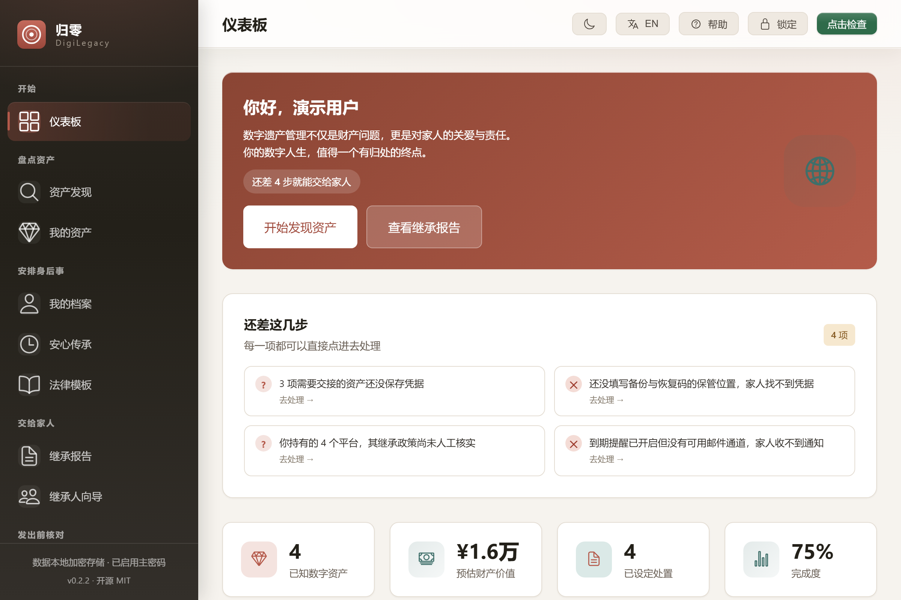
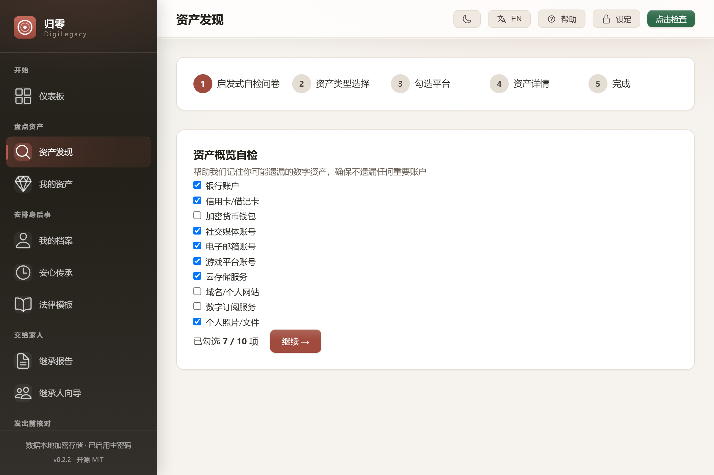
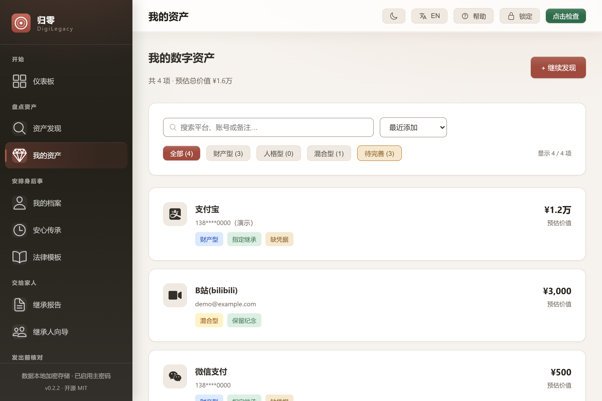
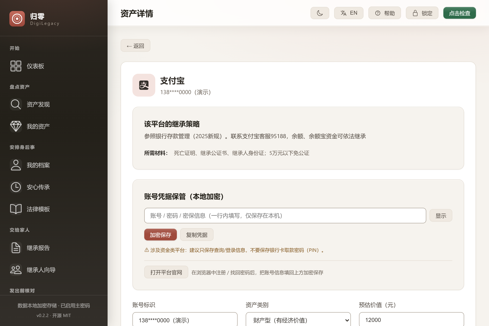
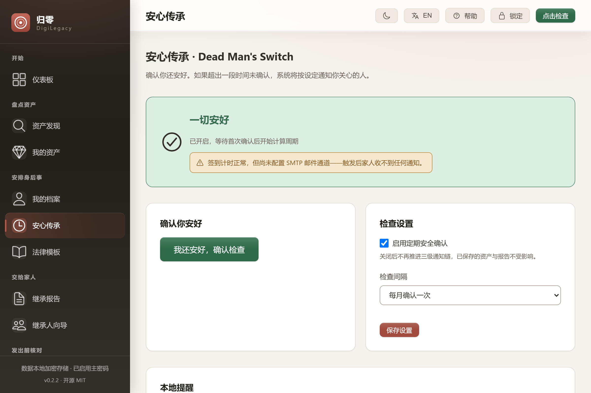
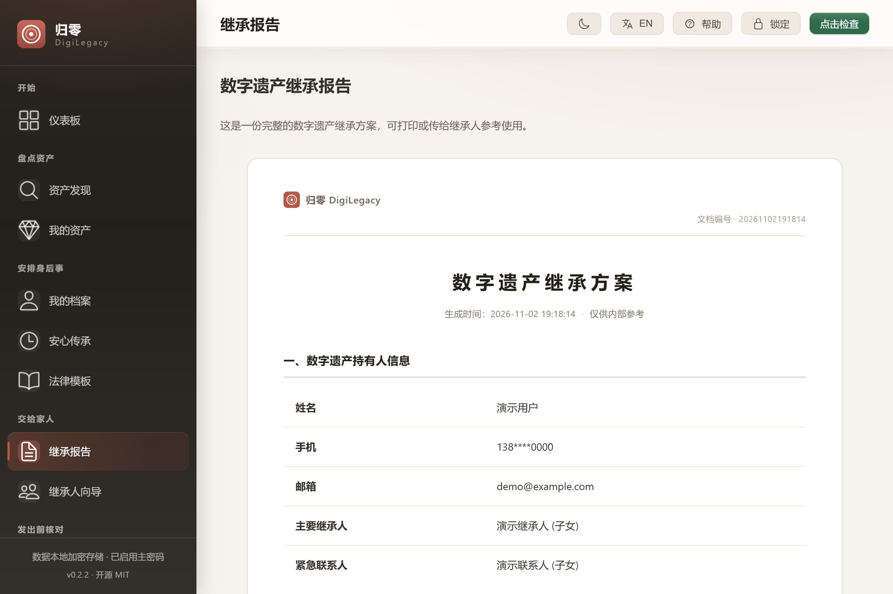
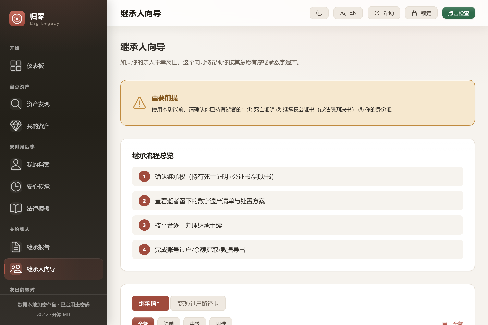
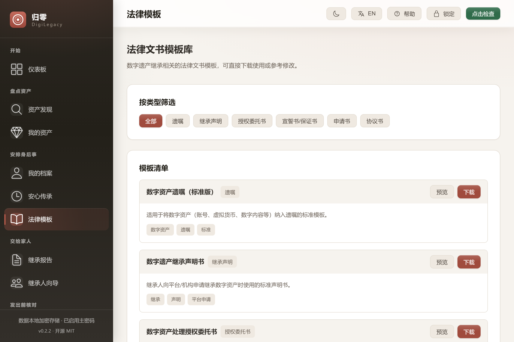
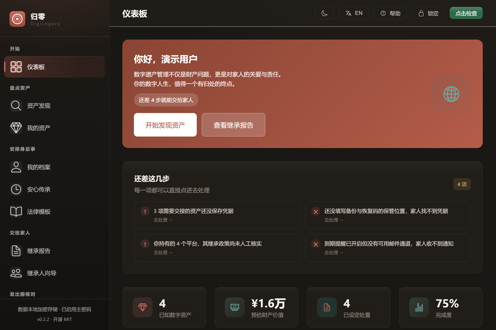

<div align="center">



<h1>DigiLegacy 归零</h1>

<p><strong>Plan your digital legacy. Leave your family a toolkit, not a puzzle.</strong></p>

<p>
  <a href="https://github.com/badhope/digilegacy/actions/workflows/ci.yml"></a>
  
  
  
  
  
</p>

<p>
  <a href="https://badhope.github.io/digilegacy/"><strong>Website</strong></a> ·
  <a href="https://badhope.github.io/digilegacy/zh/">中文官网</a> ·
  <a href="https://badhope.github.io/digilegacy/demo/"><strong>Live demo</strong></a> ·
  <a href="https://github.com/badhope/digilegacy/releases"><strong>Download</strong></a>
</p>

<p><a href="README.zh-CN.md">简体中文</a> · <strong>English</strong></p>

</div>

---

## One local workflow for digital legacy planning

DigiLegacy helps an owner discover digital assets, record handling wishes, prepare family-facing documents, configure reminders, and rehearse the handover path. The desktop app stores its working data locally by default; it does not include a hosted account, telemetry, or cloud sync.

| | |
|---|---|
| **152** platforms in the built-in policy database, across 16 categories | **83** IPC commands across a Rust core and a Vue frontend |
| New vaults use **AES-256-GCM** field encryption and Argon2id key derivation; recovery kits use Shamir threshold shares | External connections are optional and user-configured: heartbeat, SMTP/IMAP, and the BYOK assistant/Agent |

## A guided tour

<table>
<tr>
<td width="50%"><br><sub><b>Discovery</b> — a self-check questionnaire that surfaces accounts you forgot</sub></td>
<td width="50%"><br><sub><b>Your assets</b> — search, four sort orders, disposal status at a glance</sub></td>
</tr>
<tr>
<td><br><sub><b>Asset detail</b> — platform policy, disposal wish, encrypted credential vault</sub></td>
<td><br><sub><b>Dead man's switch</b> — three-stage chain: you → emergency contact → executor</sub></td>
</tr>
<tr>
<td><br><sub><b>Inheritance report</b> — print-ready document plus a ZIP toolkit</sub></td>
<td><br><sub><b>Heir guide</b> — per-platform procedure, documents and transfer path</sub></td>
</tr>
<tr>
<td><br><sub><b>Legal templates</b> — six categories, ready to fill in</sub></td>
<td><br><sub><b>Dark mode</b> — token-driven, WCAG AA contrast</sub></td>
</tr>
</table>

**[▶ Watch the 32-second walkthrough](docs/media/demo-walkthrough.mp4)** — the entire flow, no install.

## What you get

| | | |
|---|---|---|
| 🔍 **Discovery** | 152-platform policy library, guided questionnaire, de-duplication | |
| 🗂 **Registration** | Property / personality / mixed classification, per-asset detail | |
| 📝 **Disposal planning** | Inherit · liquidate · memorialize · authorize · delete · donate | |
| 📄 **Report & toolkit** | Print-ready HTML + ZIP (report, asset list, summary, instructions) | |
| ⏰ **Dead man's switch** | Three-stage confirmation chain, tray residency, optional zero-content heartbeat | |
| 👥 **Heir guidance** | Per-platform documents, procedure, transfer path, risk warnings | |
| 🔐 **Encrypted vault** | AES-256-GCM, Argon2id, idle auto-lock, one-time recovery key, encrypted backup |
| 👥 **Heir recovery kit** | Shamir threshold shares + printable recovery file + read-only drill; recovery still requires the configured vault/recovery conditions | |
| 🤖 **Optional assistant/Agent** | Uses a user-configured OpenAI-compatible endpoint; bounded local read/draft tools, visible steps, human review, and no credential/write tools | |
| 🎨 **Two themes** | Light and dark from the same design tokens, reduced-motion aware | |
| 🔎 **Search & charts** | Full-text search, sorting, ECharts composition donut | |
| 🧪 **Live demo** | Full UI in the browser on mock data — click before you install | |

## Verification status

The repository keeps historical verification records in [`docs/VERIFICATION.md`](docs/VERIFICATION.md). The 2026-11-01 local run verified the frontend, browser E2E, documentation and Rust gates using the installed MSVC toolchain; network source verification was intentionally not run.

| Check | Latest local result |
|---|---|
| Rust tests | **265 passed, 1 ignored**; 267 declared source tests |
| Frontend unit tests | **450 passing** across 32 files; coverage: 83.43% statements, 78.59% branches, 76.41% functions, 84.92% lines |
| Type safety | `npm run typecheck` passed |
| Production build | `npm run build` passed; no `mock-*` chunk |
| Demo build | `npm run build:demo` passed; this is a browser mock-data build, not the desktop backend |
| Heartbeat server behavior | `node server/heartbeat-server.test.mjs` passed |
| Documentation/policy checks | `check-doc-facts` and `check-policy-provenance` passed |
| Rust fmt | `cargo fmt --check` passed |
| Rust clippy/tests | `cargo clippy --all-targets -- -D warnings` and `cargo test --locked` passed with MSVC `cl.exe` |
| E2E | **80 passed** with `PW_CHANNEL=msedge`; coverage run also passed and produced 31-file report |

**Production boundaries:** the browser demo stores mock data in unencrypted `localStorage` and does not start the Agent. A normal desktop build excludes the mock backend. The database schema is at `PRAGMA user_version` 7; exported backups use format v5 and include the configured security/recovery metadata. IPC inputs are bounded and validated. Reports, toolkits, backups, and credential-bearing configuration files use the private-write path. Backup import defaults to non-destructive merge; explicit replace mode creates a pre-import snapshot and aborts if that snapshot cannot be written.


## Get started

**Windows 10/11 · installer size varies by release · no account or sign-up**

The desktop app works offline for local planning and exports. Optional features can make user-configured outbound connections: SMTP/IMAP, the zero-content heartbeat, or the BYOK assistant/Agent.

```bash
# Download from Releases, then run the installer.
# Your data lives in: %APPDATA%\com.digilegacy.app\digilegacy.db
```

[⬇ Download the installer](https://github.com/badhope/digilegacy/releases) · [▶ Try the live demo](https://badhope.github.io/digilegacy/demo/)

Build from source:

```bash
git clone https://github.com/badhope/digilegacy.git
cd digilegacy && npm install
npm run tauri:dev      # desktop dev
npm run tauri:build    # installers
```

## Tech stack

`Tauri 2` · `Rust` · `rusqlite` · `aes-gcm` · `argon2` · `pbkdf2` (legacy) · `Vue 3` · `TypeScript` · `Pinia` · `Vite` · `ECharts` · `Playwright` · `Vitest`

## Honest limits

Local encryption protects data at rest — it cannot stop malware running as you, or someone who knows your master password. Reports and toolkits are plain files: treat them like paper. The desktop UI ships in Simplified Chinese and English (switch in the header); the website, docs and demo are bilingual as well.

**The dead man's switch is best-effort, and the app says so.** It evaluates while the app is running; nothing is checked while the machine is off, asleep, or the app is fully quit, and missed rounds are not replayed. Email needs an SMTP server you configure yourself — without it notifications only reach the local plaintext outbox. IMAP check-in also requires a user-configured mailbox. The optional zero-content heartbeat is off by default and sends only the configured token to the endpoint you provide; it is not a hosted DigiLegacy service.

## Go deeper

- **Architecture & encryption flow** — [`docs/ARCHITECTURE.md`](docs/ARCHITECTURE.md)
- **Roadmap** (positioning review, gap list, priorities and acceptance criteria) — [`docs/ROADMAP.md`](docs/ROADMAP.md)
- **Verification evidence** (commands, numbers, known gaps) — [`docs/VERIFICATION.md`](docs/VERIFICATION.md)
- **Comparison, security notes, FAQ** — [website](https://badhope.github.io/digilegacy/#compare) · [中文](https://badhope.github.io/digilegacy/zh/#compare)
- **Contributing** — [`CONTRIBUTING.md`](CONTRIBUTING.md) · **Security policy** — [`SECURITY.md`](SECURITY.md)

## License

MIT. Five mirrors: [GitHub](https://github.com/badhope/digilegacy) · [x33834](https://github.com/x33834/digilegacy) · [Morningstar202604](https://github.com/Morningstar202604/digilegacy) · [Gitee](https://gitee.com/badhope/digilegacy) · [GitCode](https://gitcode.com/badhope/digilegacy).
