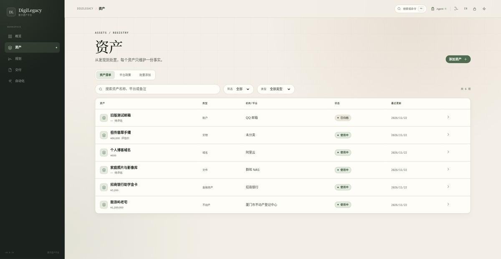
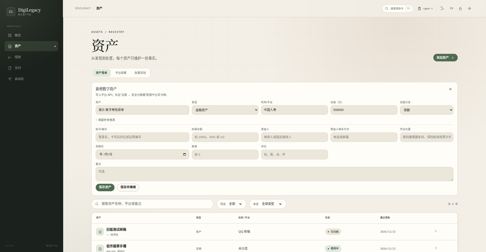
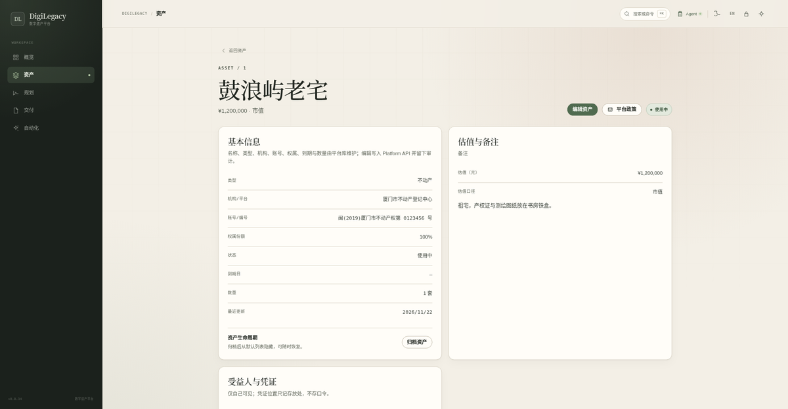

# DigiLegacy

English | [简体中文](README.zh-CN.md)

Self-hosted digital legacy planning for the accounts, files and property you leave behind. Map what you own, name who receives it, define when it is released, and export instructions your family can actually use.

[Documentation](docs/README.md) · [Architecture](docs/ARCHITECTURE.md) · [Contributing](CONTRIBUTING.md) · [Security](SECURITY.md)

## What it covers

- **Assets.** A practical inventory of accounts, subscriptions, devices and other digital property, with the inheritance rules for each platform.
- **Planning.** Heirs, an executor and a release chain that records check-ins and can pause before anything is delivered.
- **Delivery.** Reports, checklists, legal templates and a family toolkit generated from the same records.
- **Automation.** An Agent that can read, plan and draft. Any action that changes data waits for human approval.
- **Operations.** Encrypted connections, notification channels, background jobs and an audit hash chain.

Sensitive fields are encrypted before they reach the database, and exports are blocked while the vault is locked.

## Screenshots

**Asset list and depth-field entry**

| Asset list | Single-record form |
| :---: | :---: |
|  |  |
| Type filters and archived state | Base fields plus the expanded depth fields |

**Valuation and permanent delete**

| Asset detail | Delete confirmation |
| :---: | :---: |
|  |  |
| Valuation basis, ownership and beneficiary details | Permanent delete after archive, with confirmation |

Screens taken from the 0.0.34 browser acceptance run against an isolated demo database.

## How it works

```text
Web console        CLI        MCP        HTTP clients
      \             |          |            /
       \            |          |           /
        └────── Platform API / CommandBus ──────┘
                           |
                 domains and application
                           |
              store · security · integrations
                           |
                 audit · jobs · approvals
```

Every entry point calls the same command layer. Commands are declared once in `contracts/` and generated into Rust, TypeScript, OpenAPI and tool manifests, so the interfaces stay in sync. The backend is a Rust modular monolith; the console is Vue 3; storage is SQLCipher with field-level encryption for secrets and personal data.

## Quick start

You need Rust, Node.js and a C toolchain for SQLCipher.

```bash
node tools/generate.mjs

DIGILEGACY_BIND=127.0.0.1:8787 \
DIGILEGACY_API_TOKEN=change-me \
cargo run -p digilegacy-server

cd web
npm install
npm run dev
```

Open `http://127.0.0.1:5173`. Write actions use the token configured in **Settings → Connections**.

CLI and MCP are local entry points too:

```bash
cargo run -p digilegacy-cli -- health
cargo run -p digilegacy-cli -- commands --json

printf '%s\n' \
  '{"jsonrpc":"2.0","id":1,"method":"initialize","params":{}}' \
  '{"jsonrpc":"2.0","id":2,"method":"tools/list"}' \
  | cargo run -p digilegacy-mcp
```

## Repository layout

```text
core/          domain logic, contracts, storage, security, integrations
apps/          HTTP server, CLI and MCP entry points
web/           Vue console
contracts/     commands, tools, errors, schemas and generated OpenAPI
content/       policy data and translations
docs/          product, architecture, operations and delivery docs
tools/         generators, architecture checks and release gates
```

## Documentation

- [Documentation index](docs/README.md)
- [Product positioning](docs/POSITIONING.md)
- [Architecture](docs/ARCHITECTURE.md)
- [Verification and release gates](docs/VERIFICATION.md)
- [Operations](docs/operations/README.md)
- [Governance](docs/GOVERNANCE.md)
- [简体中文文档](docs/zh-CN/README.md)

## Contributing

Read [CONTRIBUTING.md](CONTRIBUTING.md) before changing a command, schema or policy. Report security issues through [SECURITY.md](SECURITY.md), not a public issue.

## License

MIT. See [LICENSE](LICENSE).
