<div align="center">

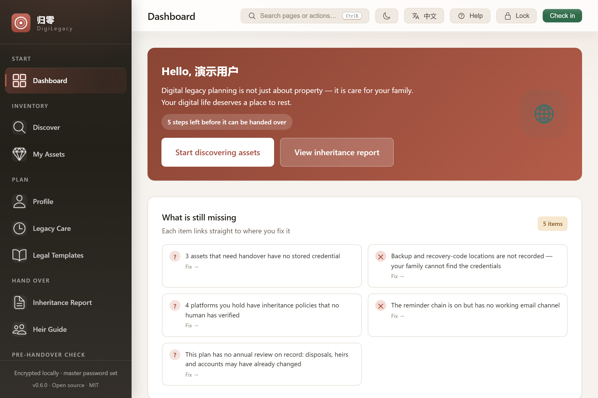

<h1>DigiLegacy</h1>

<p><strong>Plan your digital legacy. Leave your family a toolkit, not a puzzle.</strong></p>

<p>
  <a href="https://github.com/badhope/digilegacy/actions/workflows/ci.yml"></a>
  <a href="https://github.com/badhope/digilegacy/releases/latest"></a>
  
  
  
  
</p>

<p>
  <a href="https://badhope.github.io/digilegacy/"><strong>Website</strong></a> ·
  <a href="https://badhope.github.io/digilegacy/zh/">中文官网</a> ·
  <a href="https://badhope.github.io/digilegacy/demo/"><strong>Live demo</strong></a> ·
  <a href="https://github.com/badhope/digilegacy/releases"><strong>Download</strong></a>
</p>

<p><strong>English</strong> · <a href="README.zh-CN.md">简体中文</a></p>

</div>

---

A local-first Windows desktop app for digital legacy planning. It inventories the accounts and assets you hold, records what should happen to each one, and produces the documents, checklists and recovery material your family needs to act on it.

Everything runs on your machine. No account, no cloud sync, no telemetry. External connections — mail delivery, check-in heartbeat, an optional AI assistant — exist only when you configure them yourself.

**[▶ Watch the 32-second walkthrough](docs/media/demo-walkthrough.mp4)** — the whole flow, no install required.

## What it does

| | |
|---|---|
| 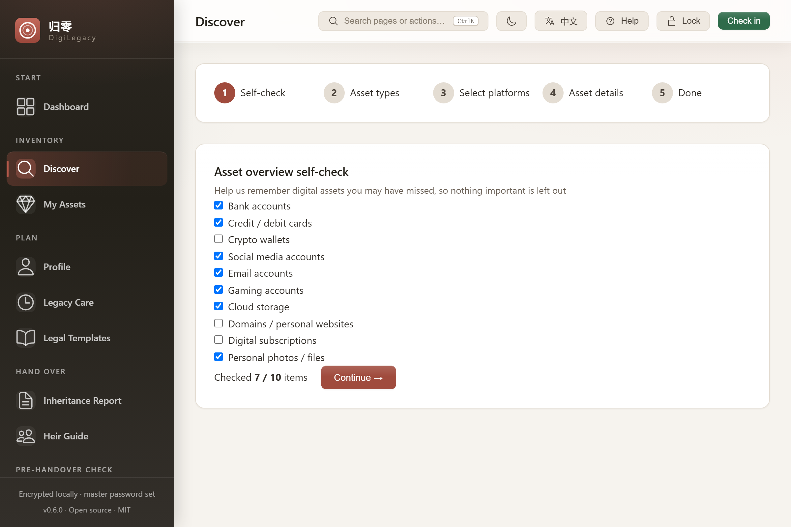<br>**Find what you've forgotten**<br>A ten-question self-check surfaces accounts people routinely leave behind, backed by a policy library covering 152 platforms across 16 categories. | 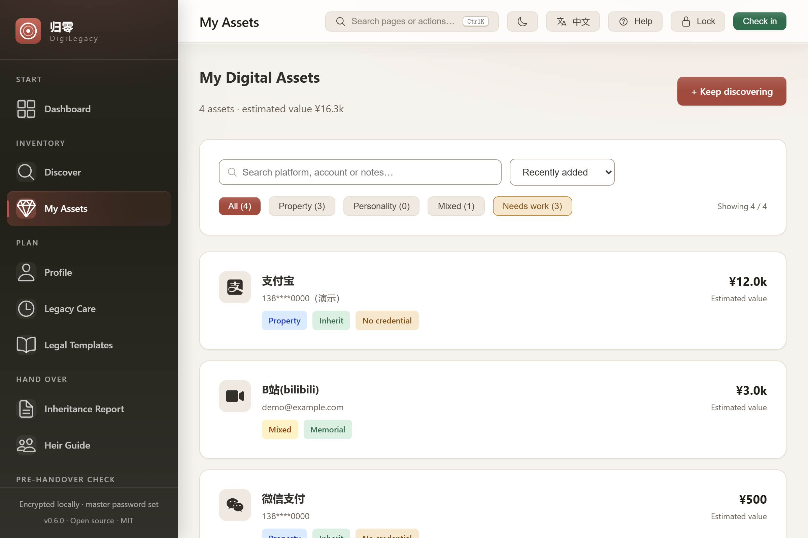<br>**Record a decision for each one**<br>Inherit, liquidate, memorialise, authorise access, delete or donate — with the heir, contact and identifier each decision requires. |
| 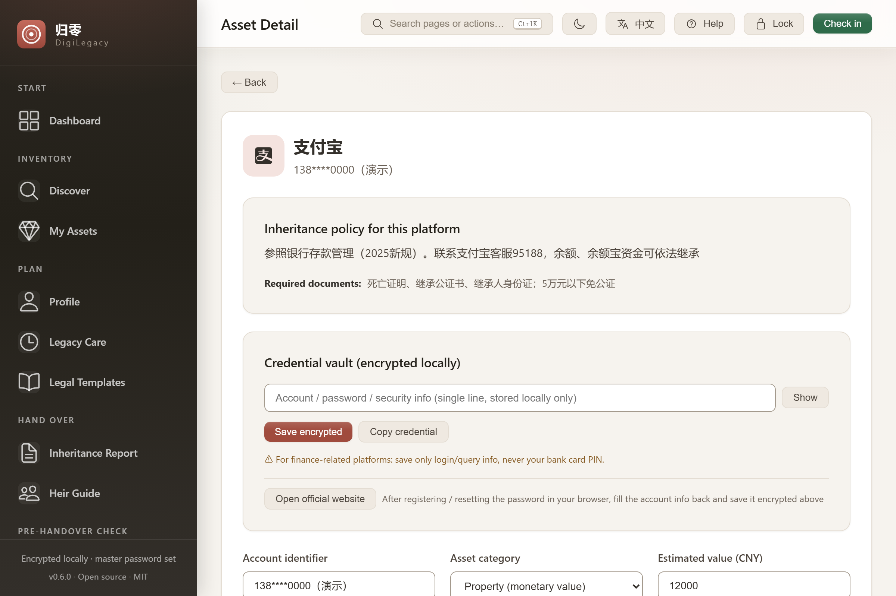<br>**Keep credentials encrypted**<br>AES-256-GCM per-field encryption, Argon2id key derivation, idle auto-lock. Credential reads fail closed while locked rather than returning empty strings. | 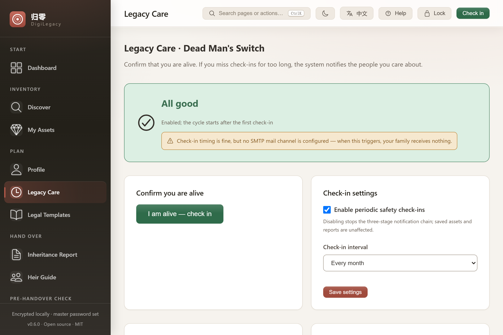<br>**Know when you've gone quiet**<br>A three-stage dead man's switch — you → emergency contact → executor — with an honest warning when no mail channel is configured. |
| 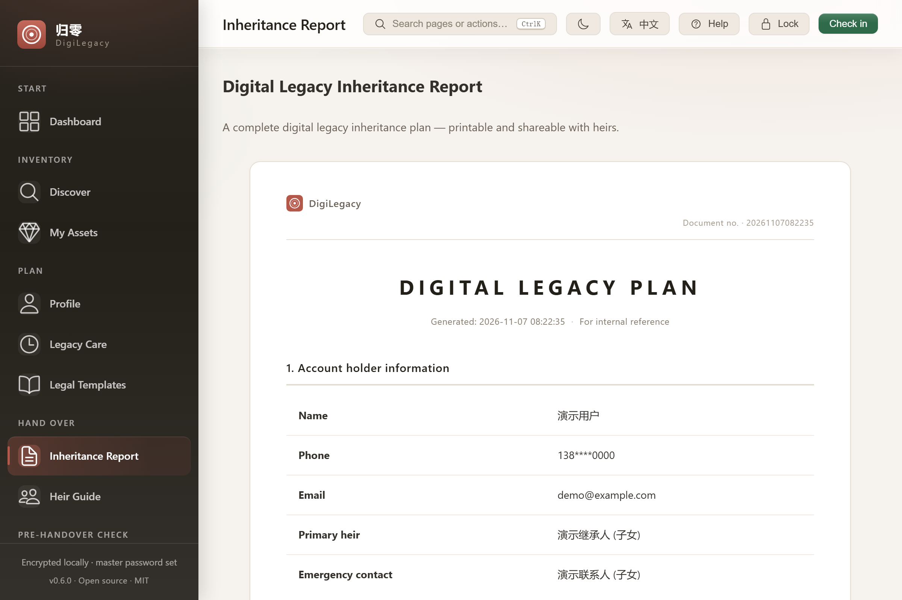<br>**Hand over something usable**<br>A print-ready inheritance report plus a ZIP toolkit: asset list, per-platform action guide, family FAQ and instructions. | 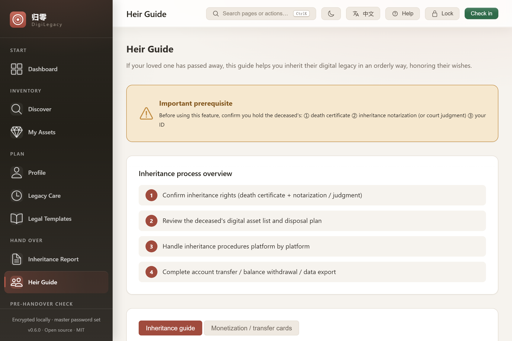<br>**Give heirs a route, not a riddle**<br>Per-platform documents, procedure, expected duration, difficulty and official links — grouped so someone grieving can follow it. |
| 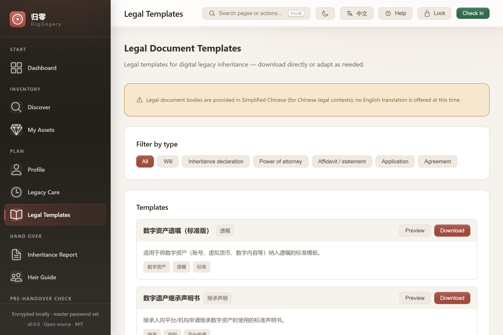<br>**Start from real templates**<br>Six categories of legal documents with the blanks marked, plus an explicit note that templates are not legal advice. | 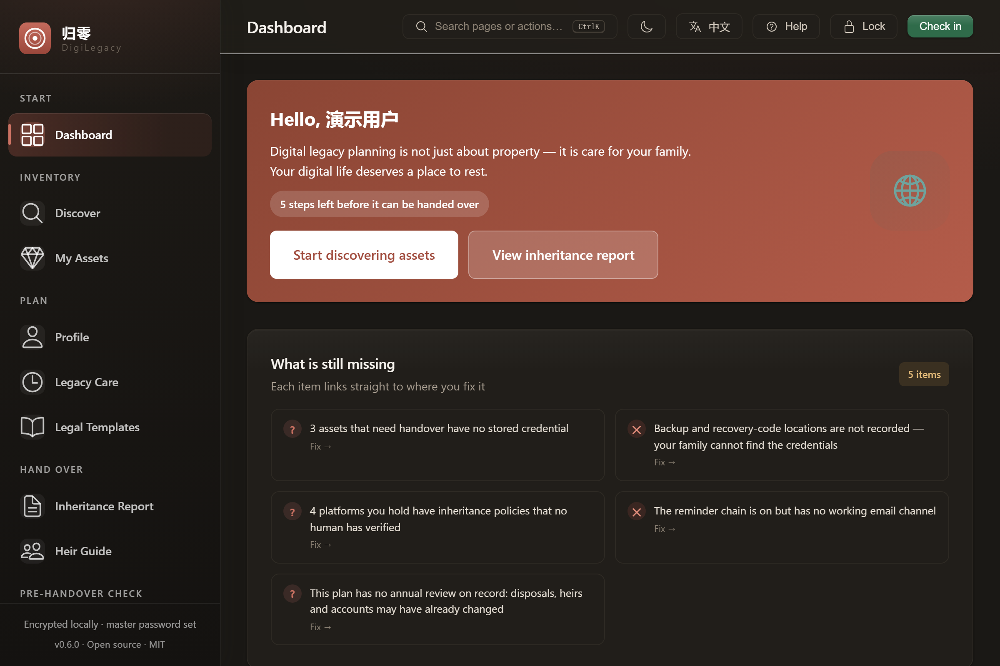<br>**Work in either theme**<br>Light and dark from the same design tokens, reduced-motion aware, WCAG AA contrast. |

## How the six-stage flow fits together

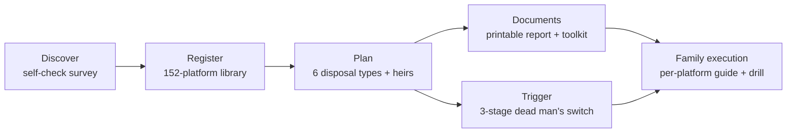

## Works with your AI agent (MCP)

The same read-only tool set the built-in assistant uses is also exposed over
**MCP** (Model Context Protocol) — point Claude Desktop, Cursor, WorkBuddy or
any MCP client at the bundled `digilegacy-mcp.exe` and ask about planning
progress, drills or platform policies. No cloud, no credentials leave the
machine, locked fields stay locked:

```json
{ "mcpServers": { "digilegacy": { "command": "C:\Program Files\DigiLegacy\digilegacy-mcp.exe" } } }
```

## Interaction, not just features

- **Command palette (⌘K / Ctrl+K).** Jump to any screen or run theme / language / lock without leaving the keyboard. Type to filter, ↑↓ to move, Enter to run.
- **Checkpoints.** Take a named snapshot before a significant edit. Restore is one click and goes through the same authenticated-import checks as a backup — and the restore itself is undoable because a `pre-restore` checkpoint is written first.
- **A dashboard that answers "what now".** One completion ring for the headline number, a four-dimension bar underneath it, and an issue list where every row is a link to the fix.
- **Search that keeps up.** The asset list and the 152-entry platform library debounce input before filtering, so typing stays smooth as the plan grows.

## Three ways to run it

The plan lives in one SQLite file. Three front doors open it — the same command layer serves all of
them, so nothing is implemented twice.

| | Desktop | CLI | Self-hosted web |
|---|---|---|---|
| Best for | everyday planning, printing | scripting, backups, headless machines | reading your plan from another device on your own network |
| Start with | `DigiLegacy.exe` | `digilegacy-cli doctor` | `digilegacy-server --web-dir dist` |
| Needs a GUI | yes | no | no (browser only) |
| Writes | full | full | **read-only** unless `--allow-write` |

```bash
# CLI — everyday checks and backups, no window
digilegacy-cli doctor
digilegacy-cli assets list --json
digilegacy-cli backup checkpoint "before tax season"
digilegacy-cli report export --locale en

# Web — serve the same database to your own browser
npm run build:web
digilegacy-server --web-dir dist --port 8787
```

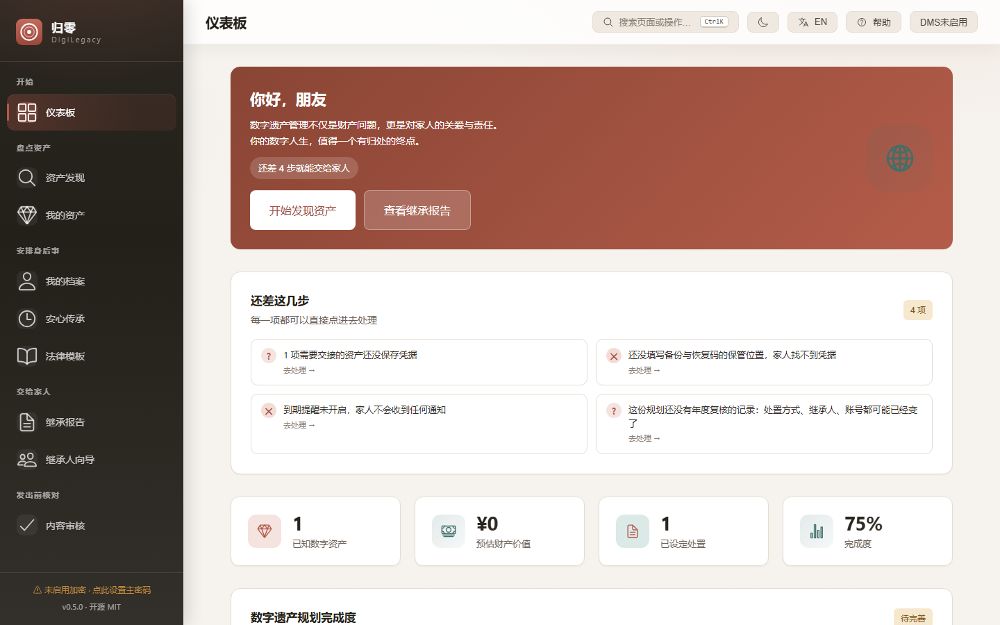

The HTTP service binds to `127.0.0.1` by default. Point it at any other interface and it refuses to
start without `--token`; even then, master-password, recovery, credential and outbound-network
commands are not reachable over HTTP at all. It is a viewer for your own machine, not a cloud
account.

## Install

**Windows 10/11** · no account required · MSI and NSIS installers on the [releases page](https://github.com/badhope/digilegacy/releases).

Your data lives at `%APPDATA%\com.digilegacy.app\digilegacy.db`. Reports, toolkits and backups are written as ordinary open files — HTML, JSON and ZIP — so they stay readable without this app.

Build from source:

```bash
git clone https://github.com/badhope/digilegacy.git
cd digilegacy
npm ci
npm run tauri:dev      # desktop app with hot reload
npm run tauri:build    # MSI + NSIS installers
```

Requires Node 22.22.2 (see `.nvmrc`), Rust stable, and the Tauri system dependencies for your platform. On Windows the SQLCipher build additionally needs a Perl distribution with `ExtUtils::MakeMaker` and `nasm` — `choco install strawberryperl nasm -y` is enough. No separate OpenSSL install: it is compiled from source as part of the build.

## Security model

| Concern | How it is handled |
|---|---|
| Data at rest | Sensitive fields are AES-256-GCM encrypted before they reach SQLite. A random data key encrypts fields; the password-derived key only wraps that data key, so changing the password is a rewrap rather than a full re-encryption. |
| Key derivation | Argon2id (m=19 MiB, t=2, p=1) for new vaults, with explicit upper bounds on memory, iterations and parallelism. Legacy PBKDF2 vaults still open. |
| Locked state | Decryption is refused in the Rust layer, not hidden behind a UI overlay. |
| Backups | Authenticated import: the source password, wrapped key, verifier and AEAD tag must all check out. Tampered or unauthenticated ciphertext is rejected. Import defaults to a non-destructive merge and writes a pre-import snapshot first. |
| Recovery | Shamir threshold shares plus a printable recovery kit. Recovery still requires the vault and recovery conditions you configured. |
| Outbound data | Nothing leaves the machine unless you configure it. The optional assistant sends a whitelisted payload — platform name, category, disposal method, policy fields, your question — and never accounts, names, contacts, amounts or credentials. |

## Honest limits

- Local encryption protects data at rest. It cannot stop malware running as you, or someone who knows your master password.
- The dead man's switch only evaluates while the app is running. Nothing is checked while the machine is off, asleep, or the app is fully quit, and missed rounds are not replayed.
- Email delivery needs an SMTP server you configure. Without one, notifications only reach a local plaintext outbox — the app says so on the dashboard and on the reminder page rather than implying your family will be notified.
- Reports and toolkits are plain files. Treat them like paper.
- 147 of the 152 built-in policy entries are explicitly marked **unverified**. The provenance gate prevents that number from growing, and never fills in a source automatically.

## Repository

```
digilegacy/            Vue 3 + TypeScript frontend, and the Rust core under src-tauri/
docs/                  Static site (EN + 中文), demo build, screenshots, architecture and verification records
scripts/verify.sh      Local gate — the same commands CI runs
```

| Gate | Command |
|---|---|
| Frontend types | `npm run typecheck` |
| Frontend tests + coverage thresholds | `npm run test:coverage` |
| Production and demo builds | `npm run build` · `npm run build:demo` |
| Browser E2E | `npx playwright test` |
| Rust format / lint / tests | `cargo fmt --check` · `cargo clippy --all-targets -- -D warnings` · `cargo test --locked` |
| Documentation facts | `node scripts/check-doc-facts.mjs` |
| Policy provenance | `node scripts/check-policy-provenance.mjs` |

`bash scripts/verify.sh --with-e2e` runs all of them in order.

## Documentation

- [Architecture and encryption flow](docs/ARCHITECTURE.md)
- [Roadmap and positioning review](docs/ROADMAP.md)
- [Verification records](docs/VERIFICATION.md) — commands, numbers and known gaps
- [Landscape review](docs/LANDSCAPE.md) — 12 open-source peers, verified metadata, and exactly which ideas were adopted where
- [Competitive teardown](docs/COMPETITIVE.md) — 20+ comparable products, what was learned and what was rejected
- [Tech-stack audit](docs/TECH-STACK.md) — every wheel checked: mature libraries vs deliberate in-house parts
- [AI integration boundaries](docs/AI_INTEGRATION.md) — including the MCP server contract
- [Contributing](CONTRIBUTING.md) · [Security policy](SECURITY.md) · [Code of conduct](CODE_OF_CONDUCT.md) · [Changelog](CHANGELOG.md)

## Project status

Early but complete: the six-stage flow — discovery, registration, disposal planning, legal documents, expiry trigger, family execution — runs end to end. The remaining risk is not missing features but whether a family can complete the handover without help, which is why the app produces printable guidance and a rehearsal drill rather than assuming the owner will be around to explain.

Mirrors: [GitHub](https://github.com/badhope/digilegacy) · [Gitee](https://gitee.com/badhope/digilegacy) · [GitCode](https://gitcode.com/badhope/digilegacy).

## Licence

MIT.
