<div align="center">

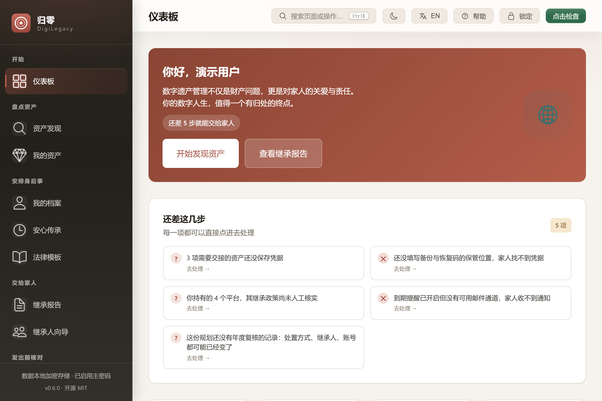

<h1>归零 DigiLegacy</h1>

<p><strong>规划你的数字遗产。给家人留下工具包，而不是一堆谜题。</strong></p>

<p>
  <a href="https://github.com/badhope/digilegacy/actions/workflows/ci.yml"></a>
  <a href="https://github.com/badhope/digilegacy/releases/latest"></a>
  
  
  
  
</p>

<p>
  <a href="https://badhope.github.io/digilegacy/zh/"><strong>中文官网</strong></a> ·
  <a href="https://badhope.github.io/digilegacy/">English site</a> ·
  <a href="https://badhope.github.io/digilegacy/demo/"><strong>在线演示</strong></a> ·
  <a href="https://github.com/badhope/digilegacy/releases"><strong>下载</strong></a>
</p>

<p><strong>简体中文</strong> · <a href="README.md">English</a></p>

</div>

---

本地优先的 Windows 桌面应用，用于数字遗产规划。它盘点你持有的账号与资产，记录每项资产的处置意愿，并产出家人真正能照着办理的文书、清单与恢复材料。

所有数据都在你自己的机器上。没有账号、没有云同步、没有遥测。外部连接——邮件投递、签到心跳、可选的 AI 助手——只在你亲自配置后才存在。

**[▶ 观看 32 秒流程演示](docs/media/demo-walkthrough.mp4)** —— 不用安装就能看完整条链路。

## 它能做什么

| | |
|---|---|
| 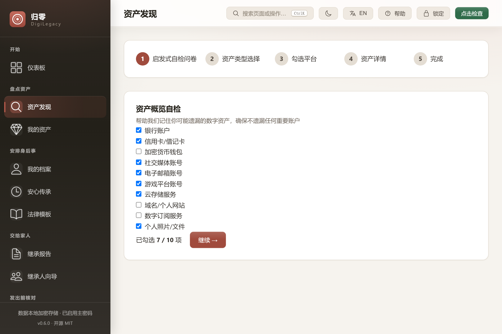<br>**想起你忘了的账号**<br>十项自检问卷把人们最常遗漏的账号翻出来，背后是覆盖 16 个分类、152 个平台的政策库。 | 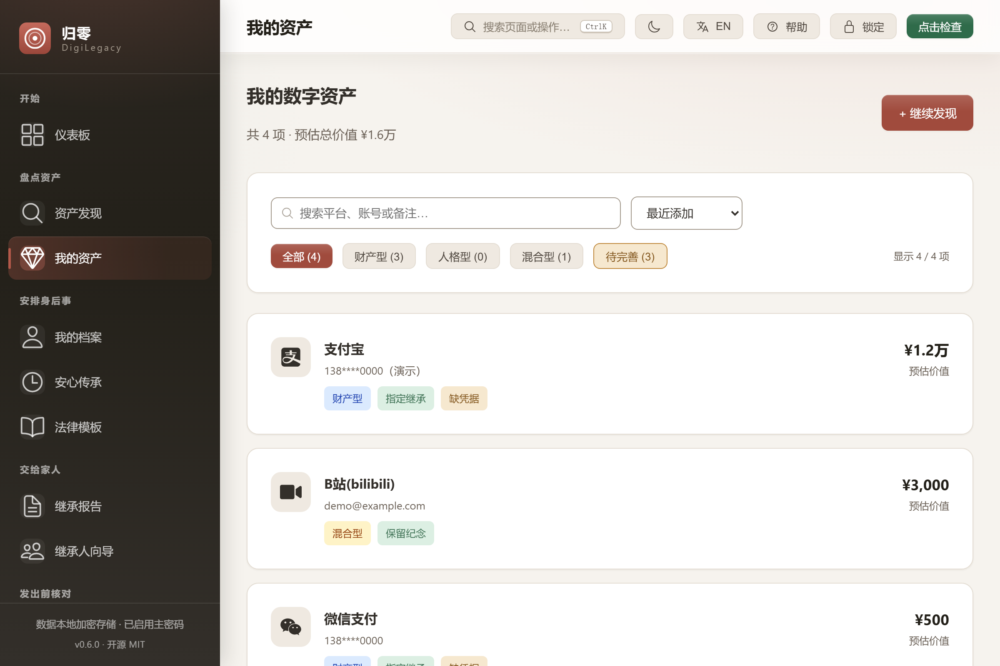<br>**为每一项留下决定**<br>继承、变卖、纪念、授权访问、删除或捐赠——每种决定都要求填上对应的继承人、联系方式与账号标识。 |
| 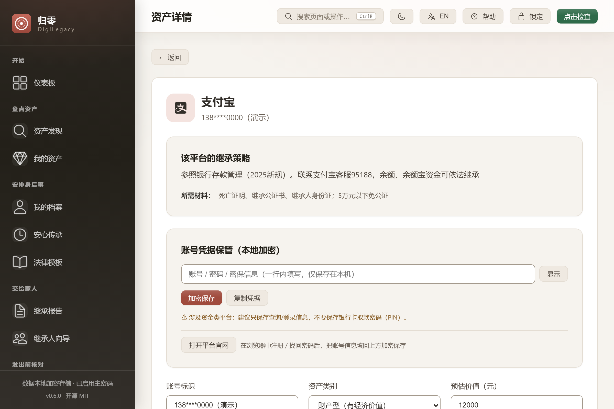<br>**凭据加密保管**<br>AES-256-GCM 逐字段加密，Argon2id 密钥派生，闲置自动锁定。锁定态下凭据读取直接报错，而不是返回空字符串。 | 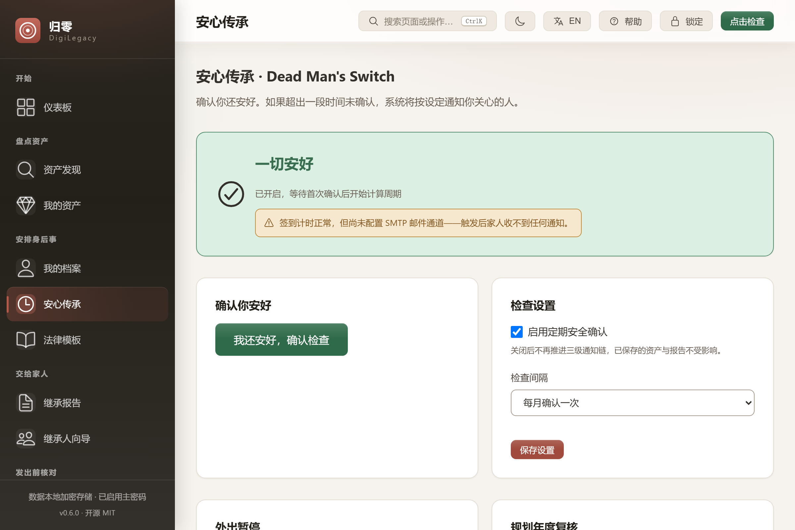<br>**知道自己何时失联**<br>三级死亡开关——本人 → 紧急联系人 → 执行人；没有配置邮件通道时会明确警告，而不是假装通知得到。 |
| 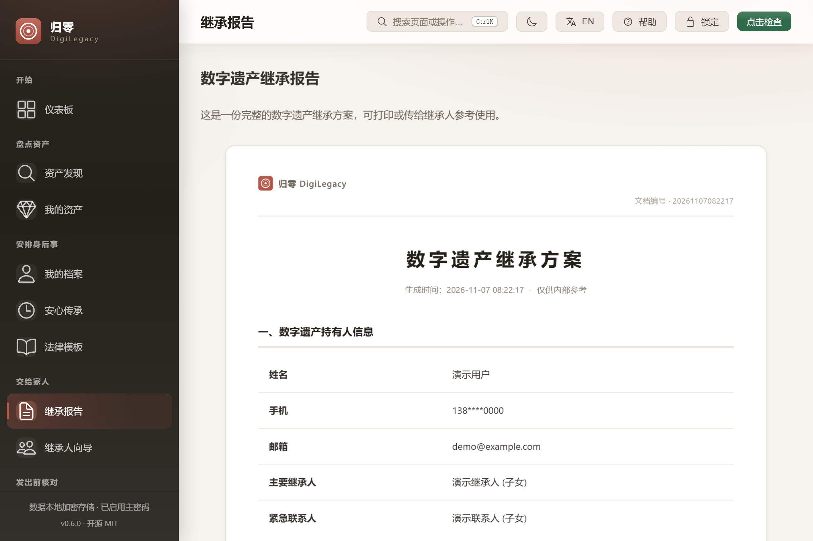<br>**交出去的东西能用**<br>可打印的继承报告 + ZIP 工具包：资产清单、按平台聚合的执行清单、家人 FAQ 与操作说明。 | 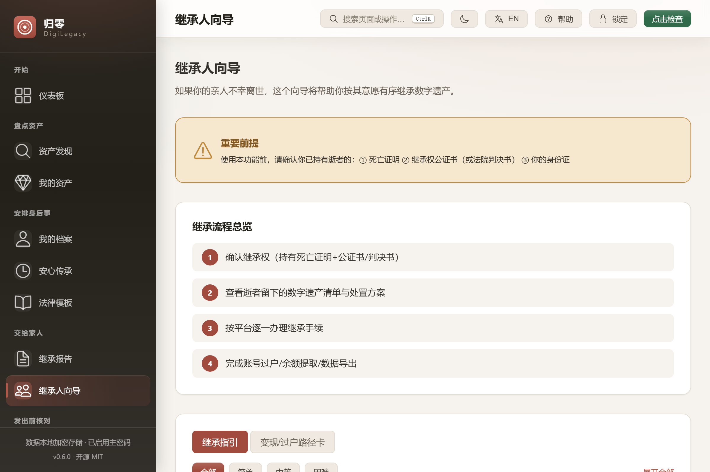<br>**给家人一条路，而不是一道谜**<br>逐平台的材料、流程、预计时长、难度与官方链接，按分类归拢，悲伤中也能照着走。 |
| 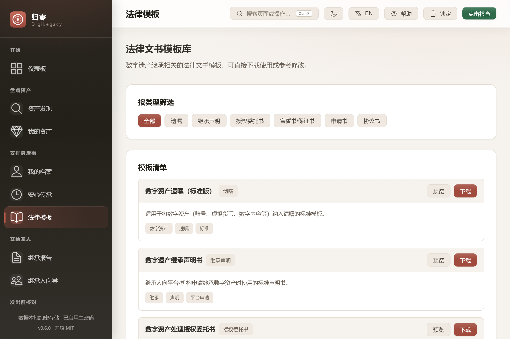<br>**从真实模板起步**<br>六类法律文书，空白项已标注；同时明确说明模板不构成法律意见。 | 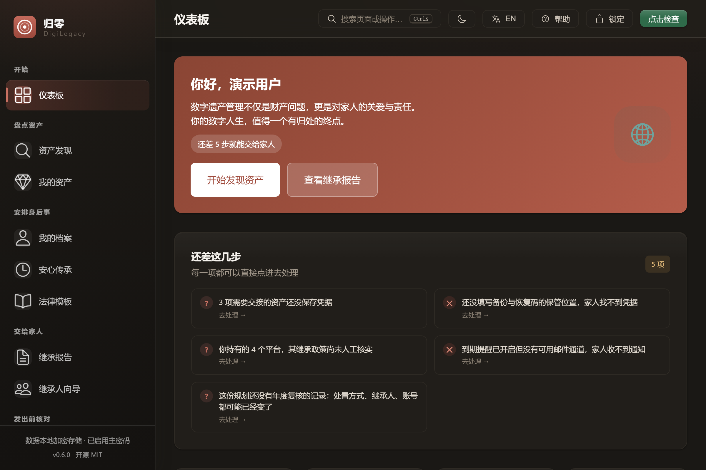<br>**两种主题都能干活**<br>同一套设计令牌驱动明暗主题，适配减少动效偏好，对比度达 WCAG AA。 |

## 六段链路如何咬合

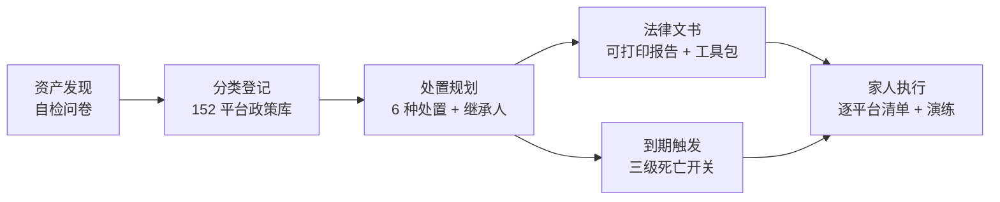

## 接入你的 AI Agent（MCP）

应用内助手使用的同一套只读工具，也通过 **MCP（Model Context Protocol）**
暴露——把 Claude Desktop、Cursor、WorkBuddy 等任意 MCP 客户端指向随包安装的
`digilegacy-mcp.exe`，即可查询规划进度、演练结果或平台政策。
不联网、凭据不出机器、锁定态字段保持锁定：

```json
{ "mcpServers": { "digilegacy": { "command": "C:\Program Files\DigiLegacy\digilegacy-mcp.exe" } } }
```

## 交互，而不只是功能

- **命令面板（⌘K / Ctrl+K）**：键盘就能到任意页面、切主题/语言/锁定。输入即过滤，↑↓ 选择，Enter 执行。
- **检查点**：重要改动前手动存一份命名快照。回滚一次点击，且与备份走同一套认证式导入校验；回滚前会自动再存一份 `pre-restore`，所以回滚本身也可撤销。
- **回答「现在该做什么」的仪表板**：一个环给总量，下面一条四维分段条给构成，再配一份每行都能直接跳到修复处的待办清单。
- **跟得上的搜索**：资产列表与 152 条平台库都先防抖再过滤，规划越长打字越不掉帧。

## 三种运行方式

规划数据始终是同一个 SQLite 文件，三个入口打开它——共用同一套命令层，不存在第二份实现。

| | 桌面版 | 命令行 | 自托管 Web |
|---|---|---|---|
| 适合 | 日常规划、打印 | 脚本化、备份、无界面机器 | 在自己局域网里的另一台设备上查看 |
| 入口 | `DigiLegacy.exe` | `digilegacy-cli doctor` | `digilegacy-server --web-dir dist` |
| 需要图形界面 | 是 | 否 | 否（只需浏览器） |
| 写入 | 全部 | 全部 | **默认只读**，除非加 `--allow-write` |

```bash
# 命令行：日常核对与备份，不开窗口
digilegacy-cli doctor
digilegacy-cli assets list --json
digilegacy-cli backup checkpoint "报税前"
digilegacy-cli report export --locale zh-CN

# Web：把同一个数据库用浏览器打开
npm run build:web
digilegacy-server --web-dir dist --port 8787
```

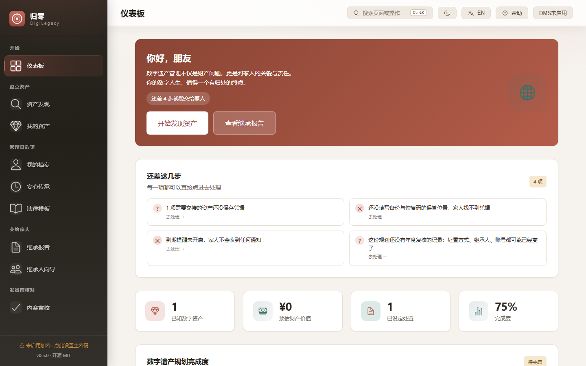

HTTP 服务默认只监听 `127.0.0.1`。绑到其它地址时必须同时给 `--token`，否则拒绝启动；即便给了，
主密码、恢复密钥、凭据与外部网络相关命令也**不通过 HTTP 暴露**。它是你自己机器的查看窗口，
不是一个云端账号。

## 安装

**Windows 10/11** · 无需注册账号 · MSI 与 NSIS 安装包见 [releases 页面](https://github.com/badhope/digilegacy/releases)。

数据位于 `%APPDATA%\com.digilegacy.app\digilegacy.db`。报告、工具包与备份都是普通的开放格式文件——HTML、JSON、ZIP——脱离本应用依然可读。

从源码构建：

```bash
git clone https://github.com/badhope/digilegacy.git
cd digilegacy
npm ci
npm run tauri:dev      # 桌面端热重载
npm run tauri:build    # 产出 MSI + NSIS
```

需要 Node 22.22.2（见 `.nvmrc`）、Rust stable，以及对应平台的 Tauri 系统依赖。Windows 上 SQLCipher 还要一个自带 `ExtUtils::MakeMaker` 的 Perl 发行版与 `nasm`——`choco install strawberryperl nasm -y` 即可；不需要单独安装 OpenSSL，它随构建一起从源码编译。

## 安全模型

| 关注点 | 处理方式 |
|---|---|
| 静态数据 | 敏感字段在写入 SQLite 前即完成 AES-256-GCM 加密。随机数据密钥加密字段，口令派生密钥只包裹该数据密钥，因此改密码是重新包裹而非全量重加密。 |
| 密钥派生 | 新保险库用 Argon2id（m=19 MiB, t=2, p=1），并对内存、迭代、并行度设显式上限。旧 PBKDF2 保险库仍可打开。 |
| 锁定态 | 解密在 Rust 层被拒绝，不是靠 UI 遮罩挡住。 |
| 备份 | 认证式导入：源口令、包裹密钥、校验器与 AEAD 标签必须全部对得上；被篡改或未经认证的密文一律拒绝。导入默认非破坏性合并，并先写导入前快照。 |
| 恢复 | Shamir 门限份额 + 可打印恢复包。恢复仍需满足你自己配置的保险库与恢复条件。 |
| 出站数据 | 不配置就不会有数据离开本机。可选助手只发送白名单字段——平台名、类别、处置方式、政策字段、你的问题——绝不含账号、姓名、联系方式、金额或凭据。 |

## 如实说明的边界

- 本地加密保护的是静态数据。它挡不住以你的身份运行的恶意软件，也挡不住知道你主密码的人。
- 死亡开关只在应用运行时评估。机器关机、休眠或应用完全退出时不检查，错过的轮次不会补跑。
- 邮件投递需要你自己配置 SMTP。没有配置时通知只进本地明文发件箱——仪表板与提醒页会明确写出来，而不是暗示家人会收到。
- 报告与工具包是普通文件。请当作纸质文件对待。
- 内置 152 条政策中，147 条显式标记为**未核实**。溯源门禁只允许这个数字下降，且绝不自动补写出处。

## 仓库结构

```
digilegacy/            Vue 3 + TypeScript 前端，Rust 内核在 src-tauri/
docs/                  静态站点（中英双语）、演示构建、截图、架构与验证记录
scripts/verify.sh      本地门禁 —— 与 CI 跑的是同一组命令
```

| 门禁 | 命令 |
|---|---|
| 前端类型 | `npm run typecheck` |
| 前端测试 + 覆盖率阈值 | `npm run test:coverage` |
| 生产与演示构建 | `npm run build` · `npm run build:demo` |
| 浏览器 E2E | `npx playwright test` |
| Rust 格式 / 静态检查 / 测试 | `cargo fmt --check` · `cargo clippy --all-targets -- -D warnings` · `cargo test --locked` |
| 文档事实一致性 | `node scripts/check-doc-facts.mjs` |
| 政策溯源 | `node scripts/check-policy-provenance.mjs` |

`bash scripts/verify.sh --with-e2e` 会按顺序跑完全部。

## 文档

- [架构与加密流程](docs/ARCHITECTURE.md)
- [路线图与定位复核](docs/ROADMAP.md)
- [验证记录](docs/VERIFICATION.md) —— 命令、数字与已知缺口
- [同类项目调研](docs/LANDSCAPE.md) — 12 个开源同类项，元数据可复核，逐条标注借鉴点落在哪个文件
- [竞品深度对照](docs/COMPETITIVE.md) —— 20+ 同类产品，学到了什么、拒绝了什么
- [技术栈审计](docs/TECH-STACK.md) —— 逐项查轮子：哪里用成熟库、哪里有意自研
- [AI 集成边界](docs/AI_INTEGRATION.md) —— 含 MCP 服务器契约
- [贡献指南](CONTRIBUTING.md) · [安全策略](SECURITY.md) · [行为准则](CODE_OF_CONDUCT.md) · [变更日志](CHANGELOG.md)

## 项目状态

早期但完整：六段链路——资产发现、分类登记、处置规划、法律文书、到期触发、家人执行——已经端到端跑通。剩余风险不是缺功能，而是家人能否在无人帮助下完成交接；这也是为什么应用产出可打印指引和演练检查，而不是假定持有人还在旁边解释。

镜像仓库：[GitHub](https://github.com/badhope/digilegacy) · [Gitee](https://gitee.com/badhope/digilegacy) · [GitCode](https://gitcode.com/badhope/digilegacy)。

## 许可

MIT。
