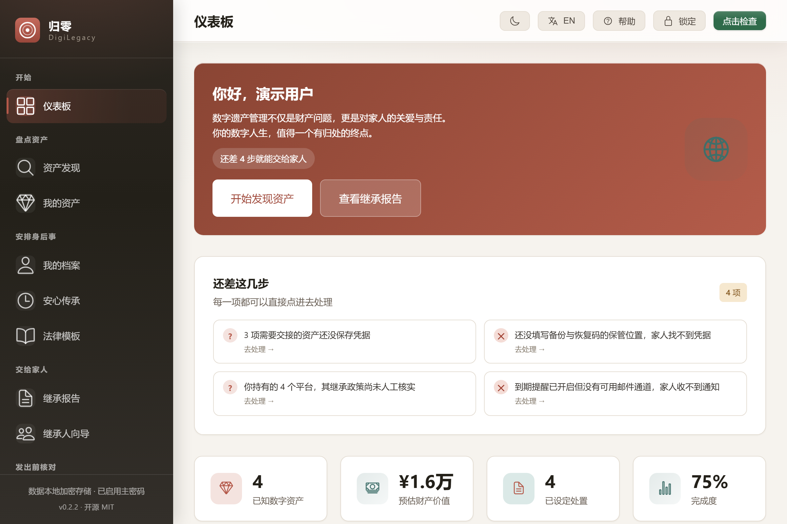
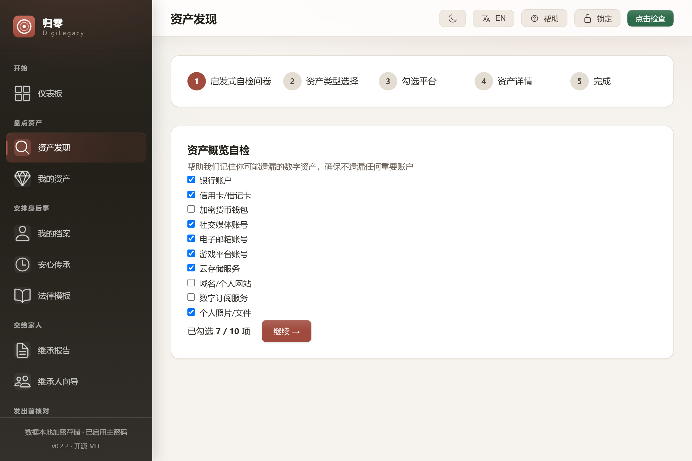
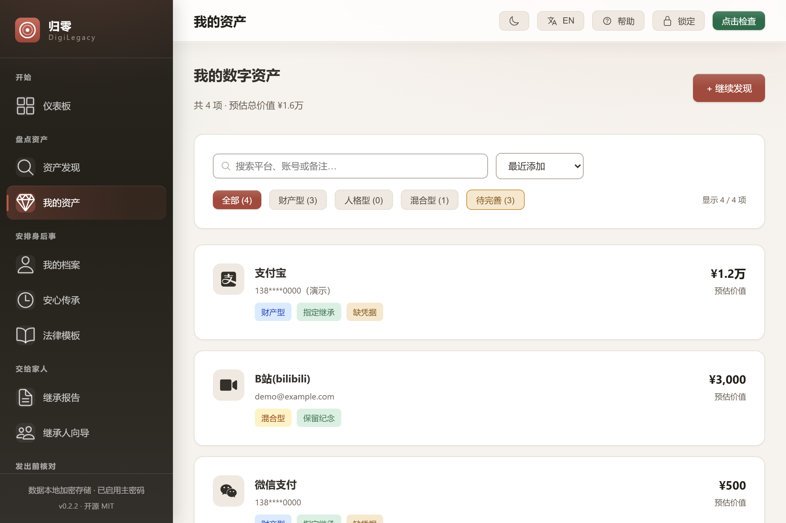
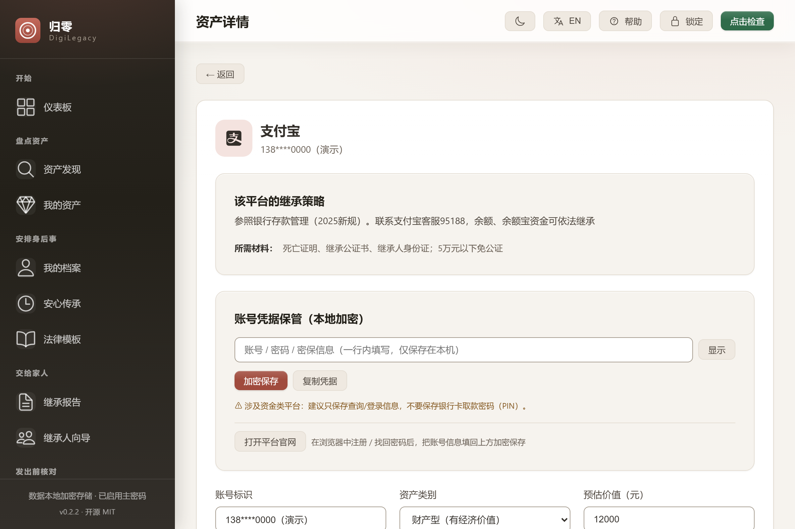
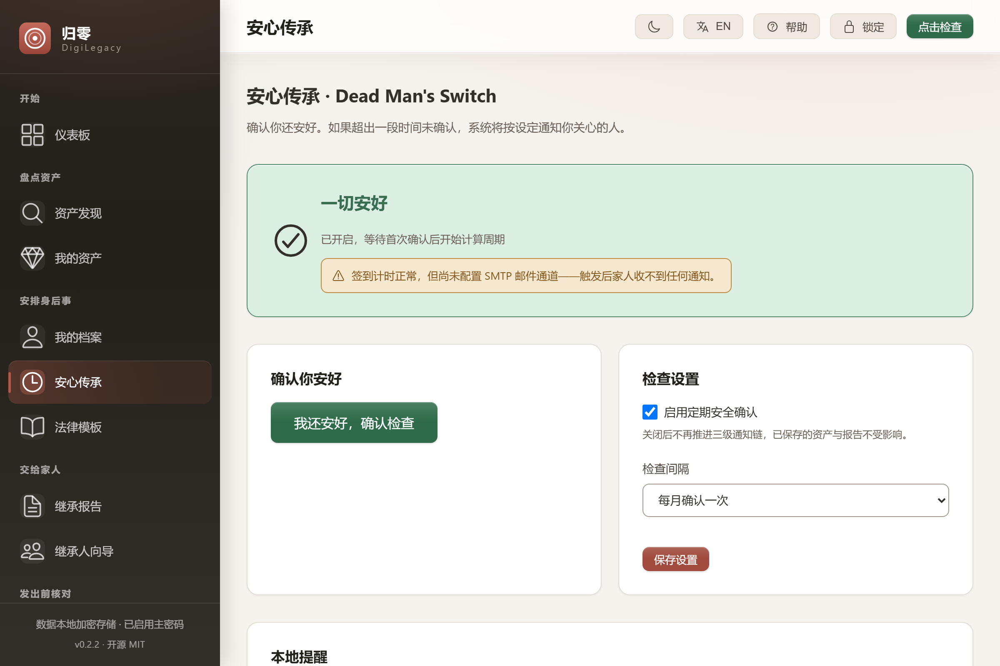
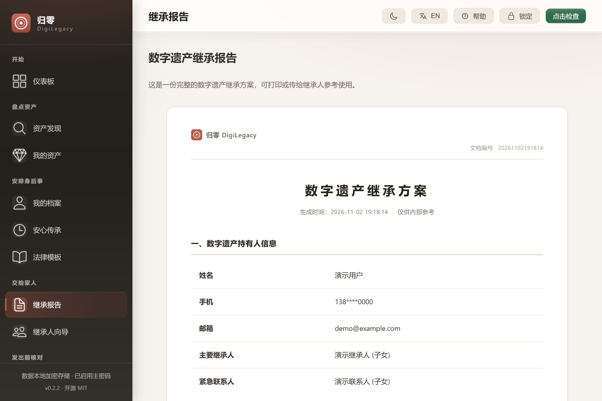
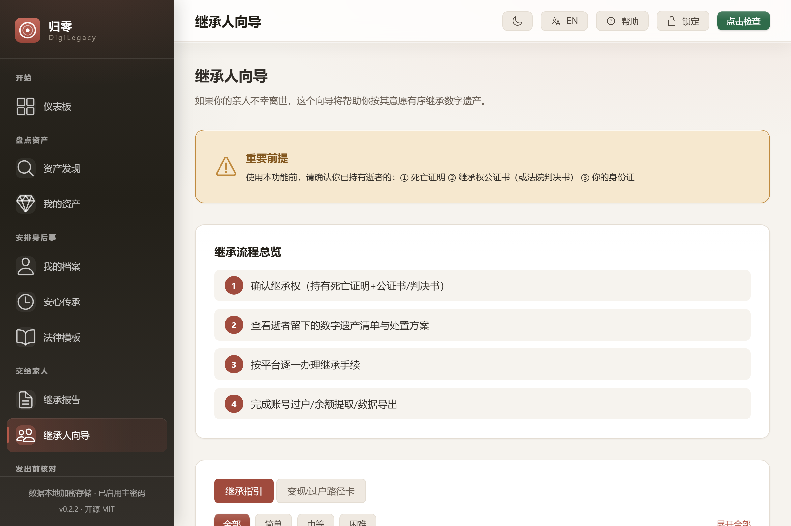
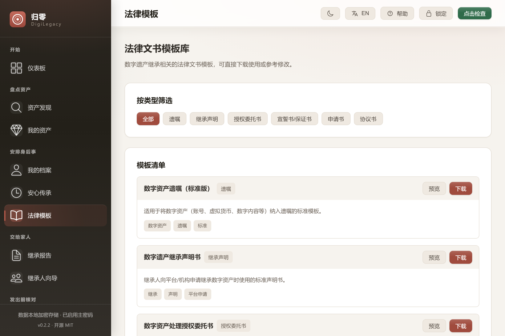
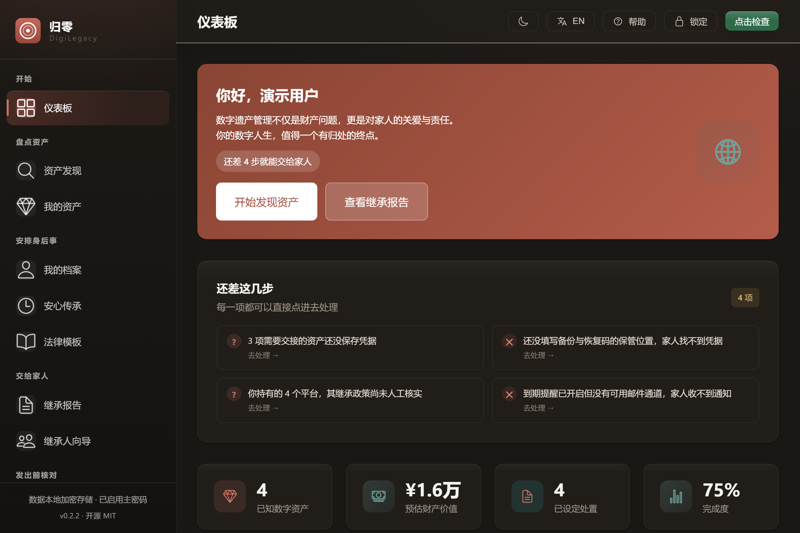

<div align="center">



<h1>归零 DigiLegacy</h1>

<p><strong>规划你的数字遗产。给家人留下工具包，而不是一堆谜题。</strong></p>

<p>
  <a href="https://github.com/badhope/digilegacy/actions/workflows/ci.yml"></a>
  
  
  
  
  
</p>

<p>
  <a href="https://badhope.github.io/digilegacy/zh/"><strong>中文官网</strong></a> ·
  <a href="https://badhope.github.io/digilegacy/">English site</a> ·
  <a href="https://badhope.github.io/digilegacy/demo/"><strong>在线演示</strong></a> ·
  <a href="https://github.com/badhope/digilegacy/releases"><strong>下载</strong></a>
</p>

<p><strong>简体中文</strong> · <a href="README.md">English</a></p>

</div>

---

## 一套本地优先的数字遗产规划流程

归零帮助持有人发现数字资产、记录处置意愿、准备面向家人的文书、配置提醒，并演练交接路径。桌面应用默认把工作数据保存在本机；不内置托管账号、遥测或云同步。

| | |
|---|---|
| 内置 **152** 个平台、覆盖 **16** 个分类的政策库 | **83** 个 IPC 命令，Rust 内核 + Vue 前端 |
| 新建保险库使用 **AES-256-GCM** 字段加密与 Argon2id 密钥派生；恢复包使用 Shamir 门限份额 | 外部连接均为可选且由用户配置：心跳、SMTP/IMAP，以及 BYOK 助手/Agent |

## 走一遍界面

<table>
<tr>
<td width="50%"><br><sub><b>资产发现</b>——问卷帮你想起早已忘记的账号</sub></td>
<td width="50%"><br><sub><b>我的资产</b>——搜索、四种排序、处置状态一眼可见</sub></td>
</tr>
<tr>
<td><br><sub><b>资产详情</b>——平台政策、处置意愿、加密凭据保管</sub></td>
<td><br><sub><b>安心传承</b>——三级链条：本人 → 紧急联系人 → 执行人</sub></td>
</tr>
<tr>
<td><br><sub><b>继承报告</b>——可打印文书 + ZIP 工具包</sub></td>
<td><br><sub><b>继承人向导</b>——按平台的流程、材料与过户路径</sub></td>
</tr>
<tr>
<td><br><sub><b>法律模板</b>——六类文书，填上就能用</sub></td>
<td><br><sub><b>深色模式</b>——token 驱动，WCAG AA 对比度</sub></td>
</tr>
</table>

**[▶ 看 32 秒全流程演示](docs/media/demo-walkthrough.mp4)**——不用安装，直接看完全程。

## 你会得到什么

| | | |
|---|---|---|
| 🔍 **资产发现** | 152 平台政策库、启发式问卷、自动去重 | |
| 🗂 **分类登记** | 财产型 / 人格型 / 混合型，逐项登记 | |
| 📝 **处置规划** | 继承 · 变现 · 纪念 · 授权查阅 · 删除 · 捐赠 | |
| 📄 **报告与工具包** | 可打印 HTML + ZIP（报告、清单、摘要、说明） | |
| ⏰ **安心传承** | 三级确认链、托盘常驻、可选零内容心跳 | |
| 👥 **继承人向导** | 按平台的材料、流程、过户路径与风险提示 | |
| 🔐 **加密保险库** | AES-256-GCM、Argon2id、闲置自动锁定、一次性恢复密钥、加密备份 | |
| 👥 **继承人恢复包** | Shamir 门限份额 + 可打印恢复文件 + 只读恢复演练；能否恢复仍取决于已配置的保险库与恢复条件 | |
| 🤖 **可选助手/Agent** | 使用用户自配的 OpenAI 兼容端点；受限的本地读取/草稿工具、步骤可见、需人工核对，且无凭据/写入工具 | |
| 🎨 **双主题** | 浅色与深色共用一套设计 token，尊重减动效偏好 | |
| 🔎 **搜索与图表** | 全文搜索、多级排序、ECharts 构成环形图 | |
| 🧪 **在线演示** | 浏览器里点遍全部界面，装之前先看 | |

## 验证状态

仓库把历史验证记录保存在 [`docs/VERIFICATION.md`](docs/VERIFICATION.md)。2026-11-01 的本地运行已验证前端、浏览器 E2E、文档与 Rust 门禁；网络来源真实性核验按本轮不联网约束未执行。

| 检查项 | 本轮本地结果 |
|---|---|
| Rust 测试 | **265 通过、1 ignored**；源码 **267 声明** |
| 前端单元测试 | **450 通过**，32 个文件；覆盖率：语句 83.43%、分支 78.59%、函数 76.41%、行 84.92% |
| 类型检查 | `npm run typecheck` 通过 |
| 生产构建 | `npm run build` 通过；无 `mock-*` 分块 |
| 演示构建 | `npm run build:demo` 通过；这是浏览器模拟数据构建，不是桌面后端 |
| 心跳服务器行为 | `node server/heartbeat-server.test.mjs` 通过 |
| 文档与政策检查 | `check-doc-facts`、`check-policy-provenance` 通过 |
| Rust 格式 | `cargo fmt --check` 通过 |
| Rust Clippy/测试 | 使用 MSVC `cl.exe` 执行通过：`cargo clippy --all-targets -- -D warnings`、`cargo test --locked` |
| E2E | `PW_CHANNEL=msedge` **80 通过**；覆盖率运行也通过并生成 31 文件报告 |

**生产边界：** 浏览器演示把模拟数据存入未加密的 `localStorage`，不会启动 Agent；正常桌面构建会排除 mock 后端。数据库 schema 当前为 `PRAGMA user_version` 7；导出备份格式为 v5，包含已配置的安全与恢复元数据。IPC 输入有长度和值域校验。报告、工具包、备份和含凭据的配置文件走私有写入路径。备份导入默认为非破坏性合并；显式覆盖模式会先创建导入前快照，快照无法写入就中止。

## 开始使用

**Windows 10/11 · 安装包大小随版本变化 · 无需账号、无需注册**

桌面应用的本地规划与导出可以离线完成。可选功能会按用户配置建立外部连接：SMTP/IMAP、零内容心跳，或 BYOK 助手/Agent。

```bash
# 从 Releases 下载安装包，双击安装。
# 数据保存在：%APPDATA%\com.digilegacy.app\digilegacy.db
```

[⬇ 下载安装包](https://github.com/badhope/digilegacy/releases) · [▶ 打开在线演示](https://badhope.github.io/digilegacy/demo/)

从源码构建：

```bash
git clone https://github.com/badhope/digilegacy.git
cd digilegacy && npm install
npm run tauri:dev      # 桌面开发
npm run tauri:build    # 产出安装包
```

## 技术栈

`Tauri 2` · `Rust` · `rusqlite` · `aes-gcm` · `argon2` · `pbkdf2`（旧格式兼容）· `Vue 3` · `TypeScript` · `Pinia` · `Vite` · `ECharts` · `Playwright` · `Vitest`

## 诚实的边界

本地加密保护的是静态数据——它挡不住以你的身份运行的恶意软件，也挡不住知道主密码的人。报告与工具包是明文文件，请像对待纸质文件一样对待它。桌面界面提供简体中文与英文（标题栏切换）；官网、文档与演示同样为双语。

**「安心传承」是尽力而为，应用里也这么写。** 它只在应用运行时检测；电脑关机、睡眠或应用被彻底退出期间不检查，也不会补发错过的轮次。邮件需要你自己配置 SMTP 服务器——没配时通知只进本地明文发件箱。IMAP 签到同样需要用户配置邮箱。可选的「零内容心跳」默认关闭，只会把用户配置的令牌发往用户提供的端点；它不是 DigiLegacy 托管的服务。

## 深入了解

- **架构与加密数据流** — [`docs/ARCHITECTURE.md`](docs/ARCHITECTURE.md)
- **路线图**（定位复核、缺口清单、优先级与验收标准）— [`docs/ROADMAP.md`](docs/ROADMAP.md)
- **验证证据**（命令、数字、已知缺口）— [`docs/VERIFICATION.md`](docs/VERIFICATION.md)
- **横向对比、安全说明、常见问题** — [官网](https://badhope.github.io/digilegacy/zh/#compare) · [English](https://badhope.github.io/digilegacy/#compare)
- **参与贡献** — [`CONTRIBUTING.md`](CONTRIBUTING.md) · **安全策略** — [`SECURITY.md`](SECURITY.md)

## 许可

MIT。五个镜像：[GitHub](https://github.com/badhope/digilegacy) · [x33834](https://github.com/x33834/digilegacy) · [Morningstar202604](https://github.com/Morningstar202604/digilegacy) · [Gitee](https://gitee.com/badhope/digilegacy) · [GitCode](https://gitcode.com/badhope/digilegacy)。
