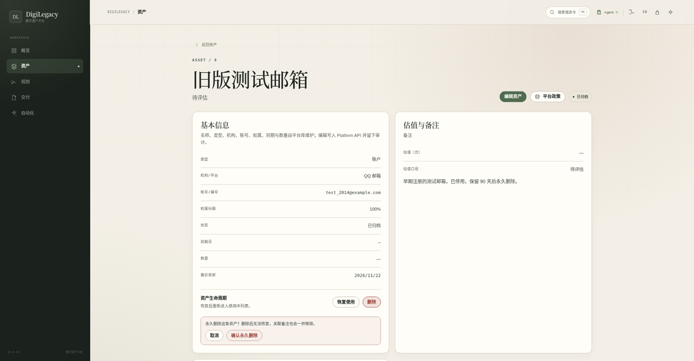

# DigiLegacy

[English](README.md) | 简体中文

自托管的数字遗产规划工具：整理你留下的账号、文件与财产，指定交给谁、何时释放，并生成家人真正能用的说明和材料。

[文档](docs/zh-CN/README.md) · [架构](docs/zh-CN/ARCHITECTURE.md) · [参与贡献](docs/zh-CN/CONTRIBUTING.md) · [安全](docs/zh-CN/SECURITY.md)

## 主要能力

- **资产。** 统一登记账号、订阅、设备和其他数字财产，并关联各平台的继承规则。
- **规划。** 继承人、执行人和释放链；释放前会记录签到，也可以暂停。
- **交付。** 用同一份记录生成报告、执行清单、法律文本模板和给家人的工具包。
- **自动化。** Agent 可以读取、规划和起草；任何改动数据的动作都要等人批准。
- **运行。** 加密连接、通知渠道、后台任务，以及可校验的审计哈希链。

敏感字段在写入数据库前加密；保险库锁定时，导出文件不会被下载。

## 界面预览

**资产总览与深字段录入**

| 资产列表 | 单条录入表单 |
| :---: | :---: |
|  |  |
| 类型筛选与归档状态 | 基础字段加展开后的深字段 |

**估值口径与物理删除**

| 资产详情 | 删除确认 |
| :---: | :---: |
|  |  |
| 估值口径、权属与受益人 | 归档后物理删除，二次确认 |

截图来自 0.0.34 隔离演示库的真实浏览器验收。

## 工作方式

```text
Web 控制台          CLI        MCP        HTTP 客户端
      \             |          |            /
       \            |          |           /
        └────── 平台 API / CommandBus ──────┘
                           |
                    领域层与应用层
                           |
              存储 · 安全 · 外部集成
                           |
                 审计 · 任务 · 审批
```

所有入口都调用同一个命令层。命令只在 `contracts/` 中声明一次，再生成到 Rust、TypeScript、OpenAPI 和工具清单，避免接口漂移。后端是 Rust 模块化单体，前端是 Vue 3，存储使用 SQLCipher，并对密钥和个人数据做字段级加密。

## 快速开始

需要 Rust、Node.js，以及用于编译 SQLCipher 的 C 工具链。

```bash
node tools/generate.mjs

DIGILEGACY_BIND=127.0.0.1:8787 \
DIGILEGACY_API_TOKEN=change-me \
cargo run -p digilegacy-server

cd web
npm install
npm run dev
```

打开 `http://127.0.0.1:5173`。写操作使用 **设置 → 连接** 中配置的写令牌。

CLI 和 MCP 也是本地入口：

```bash
cargo run -p digilegacy-cli -- health
cargo run -p digilegacy-cli -- commands --json

printf '%s\n' \
  '{"jsonrpc":"2.0","id":1,"method":"initialize","params":{}}' \
  '{"jsonrpc":"2.0","id":2,"method":"tools/list"}' \
  | cargo run -p digilegacy-mcp
```

## 仓库结构

```text
core/          领域逻辑、契约、存储、安全、外部集成
apps/          HTTP 服务、CLI 与 MCP 入口
web/           Vue 控制台
contracts/     命令、工具、错误、schema 与生成的 OpenAPI
content/       政策数据与翻译
docs/          产品、架构、运维与交付文档
tools/         生成器、架构门禁与发布门禁
```

## 文档

- [中文文档索引](docs/zh-CN/README.md)
- [产品定位](docs/zh-CN/POSITIONING.md)
- [架构说明](docs/zh-CN/ARCHITECTURE.md)
- [验证与发布门禁](docs/zh-CN/VERIFICATION.md)
- [运维文档](docs/zh-CN/operations/README.md)
- [协作治理](docs/zh-CN/GOVERNANCE.md)
- [English documentation](docs/README.md)

## 参与贡献

修改命令、schema 或政策前，请先读 [CONTRIBUTING](docs/zh-CN/CONTRIBUTING.md)。安全问题请按 [SECURITY](docs/zh-CN/SECURITY.md) 私下报告。

## 许可证

MIT，见 [LICENSE](LICENSE)。
